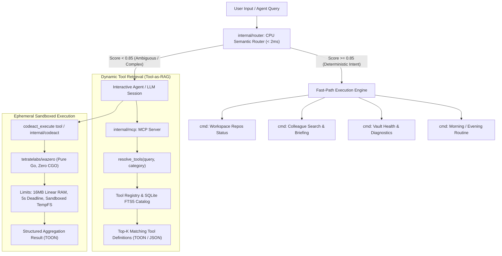

# ADR 0041: Agent Engine Optimization via Tool-as-RAG, CPU Fast-Path Router, and Wazero Sandboxing

* Status: accepted
* Date: 2026-11-12

## Context and Problem Statement

Daneel's runtime acts as a central engine and sensory nervous system for AI agents (such as Claude Code, Gemini CLI, Cursor, and Daneel's native interactive chat runner). As highlighted in modern agent architectural research (consolidated in the Second Brain knowledge base), naive ReAct (*Reason + Act*) loops and static JSON tool-calling introduce cumulative latency, token consumption explosion (FinOps), context contamination, and high risk of non-deterministic execution failure.

Specifically, profiling Daneel's interactions with AI agents reveals four architectural bottlenecks:
1. **Tool Definition Context Bloat (Handshake Inflation)**: Daneel exposes over 30 MCP tools. Injecting the complete catalog and schemas on every handshake (`tools/list`) consumes 8,000 to 15,000 tokens per session. This degrades reasoning capacity and increases Time-To-First-Token (TTFT).
2. **Deterministic Query Latency & LLM Waste**: Routine user queries (e.g., triggering a morning routine, checking vault health with `doctor`, searching colleague profiles, or inspecting workspace repos) frequently route into heavy remote LLM processes via `daneel chat` or agent sessions, taking 1 to 5 seconds and incurring cloud API costs for queries that Daneel can resolve deterministically in < 5ms.
3. **Turn Inflation in Data Transformation Workflows**: When an agent needs to perform multi-step data manipulation (e.g., paginating and cross-filtering 50 workspace repositories, aggregating telemetry metrics, or cross-referencing backlinks), standard JSON tool calls require 10 to 15 conversational roundtrips.
4. **Unsandboxed Execution Risk**: Executing agent-generated aggregation scripts directly on the host poses severe security risks, while Docker or microVM containers add 500ms to 2s startup latencies and introduce external daemon dependencies.

## Decision Drivers

* **Zero CGO Invariant**: Daneel must compile 100% statically across Linux, macOS, and Windows without requiring GCC, CGO, or external container runtimes.
* **Dramatic Handshake Token Reduction**: Eliminate context bloat by indexing the tool catalog in SQLite FTS5/BM25 and exposing dynamic tool discovery (`resolve_tools`), reducing handshake overhead by over 70%.
* **Sub-5ms Fast-Path Intent Routing on CPU**: Triage deterministic commands locally on CPU using token-weighted matching and BM25 cosine scoring without calling remote LLM APIs.
* **Sub-Millisecond Sandboxed Code-as-Action (CodeAct)**: Embed a pure Go WebAssembly (Wasm) runtime (`tetratelabs/wazero`) to run ephemeral data transformation and aggregation logic within strictly bounded memory and CPU limits.
* **Deep Architectural Cohesion**: Integrate seamlessly with existing Daneel foundations: SQLite FTS5 index, TOON serialization (ADR 0040), Robotics Guardrails (ADR 0005), and MCP server (ADR 0002).
* **Open-Source Neutrality**: Zero corporate leaks, generic mock personas (e.g. *Ada Lovelace*, *Alan Turing*), and strictly English documentation and tooltips.

## Considered Options

* **Option 1: Status Quo (Static Full Tool Manifest + Always-Launch LLM + Host Shell Scripts)**:
  * *Disadvantages*: Context window saturated with 30+ tool definitions, unnecessary remote inference costs on trivial commands, high multi-turn latency, and security hazards from executing raw host scripts.
* **Option 2: External Python Gateway & Docker Sidecar Containers**:
  * *Disadvantages*: Destroys Daneel's single-binary pure Go architecture. Introduces multi-second container boot latency, heavy memory overhead, and external daemon requirements.
* **Option 3: Pure Go Triad Architecture: Tool-as-RAG Discovery, CPU Semantic Router, and Wazero Wasm Sandbox (Chosen)**:
  * *Advantages*: Keeps Daneel 100% pure Go and CGO-free. Enables on-demand tool discovery, sub-5ms CPU fast-path query interception, and sub-millisecond sandboxed CodeAct execution.

## Decision Outcome

Chosen Option: **Option 3 — Pure Go Triad Architecture (Tool-as-RAG, CPU Semantic Router, and Wazero Wasm Sandbox)**.

### Architectural Diagram

### Component Specifications

#### 1. Dynamic Tool Retrieval (Tool-as-RAG)
- **Tool Catalog Service (`internal/mcp/catalog.go`)**:
  - Maintains an in-memory and FTS5-indexed catalog of all Daneel tools with metadata: `name`, `category` (`vault`, `people`, `workspace`, `ui`, `tui`, `routines`, `ingest`, `guard`, `codeact`), `description`, `keywords`, and input schema.
  - Exposes meta-tool `resolve_tools`:
    - Parameters: `query` (string, required), `category` (string, optional), `limit` (int, default 5).
    - Returns only the matching tool schemas in compact TOON format or JSON.
  - Supports `--dynamic-tools` flag and `mcp.tool_exposure: "dynamic"` configuration in `.daneel.yaml` to serve a minimal core manifest on `tools/list` (~5 tools) while dynamically paging specialized tools.

#### 2. Fast-Path Intent Router (`internal/router`)
- **Pure Go BM25 & Semantic Classifier**:
  - Operates completely in-memory on CPU in under 2ms.
  - Pre-tokenized intent patterns with term frequency-inverse document frequency weights across canonical workflows:
    - `routine_morning`: "morning routine", "rotina matinal", "start day", "briefing matinal"
    - `routine_evening`: "evening routine", "rotina noturna", "close day", "metacognicao"
    - `vault_health`: "doctor", "vault health", "status do cofre", "diagnostico"
    - `people_briefing`: "1:1 with <name>", "briefing <name>", "quem e <name>", "perfil <name>"
    - `workspace_status`: "workspace status", "dirty repos", "status dos projetos"
  - Evaluates match confidence: if `confidence >= 0.85`, executes the corresponding native Go handler immediately, bypassing the external agent process.
  - Integrated into `daneel chat`: checks user prompt against fast-path router before invoking `syscall.Exec`.
  - Exposes CLI command `daneel route "<prompt>"` for diagnostics and deterministic routing tests.

#### 3. Wazero-Powered Safe CodeAct Sandbox (`internal/codeact`)
- **Zero-CGO WebAssembly Runtime**:
  - Leverages `github.com/tetratelabs/wazero` for sub-millisecond module instantiation directly in Go memory.
  - Strict security sandboxing:
    - Bounded linear memory allocation (configurable, default 16MB).
    - Strict execution timeout (default 5s via Go `context`).
    - WASI Preview 1 isolation: ephemeral scratch directory in memory or tempdir, zero host network access, zero access to the host filesystem outside the scratch area.
    - Full alignment with Daneel's Robotics Guardrails (ADR 0005).
  - MCP Tool `codeact_execute`:
    - Accepts Wasm bytecode (or pre-compiled WASI transformation binaries) along with input data (JSON/TOON).
    - Captures stdout/stderr safely and returns the processed output to the agent in 1 turn, reducing multi-turn loops by 80%+.

#### 4. Extended TOON Coverage
- Extend TOON encoding to remaining high-value MCP endpoints: `person_briefing` (`briefing[1]{...}` and sub-arrays).
- Add `--toon` / `-T` flag support to `daneel prep` and `daneel dossier`.

## Pros and Cons of Options

### Option 3 (Pure Go Triad Architecture)

* Good, because it adheres strictly to the Zero CGO and single-binary deployment invariant of Daneel.
* Good, because it slashes handshake prompt token overhead by > 70% with dynamic tool retrieval.
* Good, because sub-5ms CPU fast-path eliminates unnecessary API billing and latency on standard commands.
* Good, because wazero provides genuine capability-based sandboxed computation without Docker.
* Bad, because it introduces the `tetratelabs/wazero` dependency into `go.mod` (adds ~12MB to compiled binary size, but remains completely dependency-free of CGO and host libraries).

## More Information

- Second Brain Note: `notes/ia/otimizacao-arquitetura-agentes-ia.md`
- Related ADRs: [ADR 0002](0002-ambient-intelligence-and-unified-mcp-ui-tools.md), [ADR 0005](0005-robotics-security-guardrails.md), [ADR 0040](0040-token-oriented-object-notation-toon.md)
