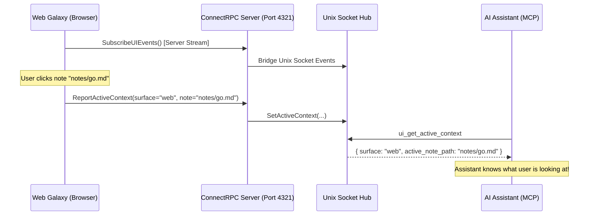

# Spatial Context & Ambient Intelligence

Daneel implements an **Ambient Intelligence** pattern where external AI assistants (via MCP) share spatial awareness with the human user: knowing which note they are reading, which galactic sector they are inspecting, or what text they have highlighted.

## 1. Active Context Schema

The daemon tracks user context in memory via a thread-safe `Hub`:

```go
type ActiveContext struct {
    Surface        Surface   // "web" | "tui" | "none"
    ActiveNotePath string    // e.g. "notes/arquitetura/microservices.md"
    FocusedDomain  string    // e.g. "notes/arquitetura" (alias: FocusedSector)
    SelectedText   string    // Current text selection in viewport
    UpdatedAt      time.Time // Last heartbeat or interaction timestamp
}
```

## 2. ConnectRPC Streaming Protocol

Communication between the Web client and the server is handled via **ConnectRPC** (defined in `api/v1/graph.proto`):

- **`SubscribeUIEvents` (Server Streaming)**: The Web browser opens a persistent HTTP/2 or gRPC-Web stream. The server yields `UIEvent` messages as they are published by the daemon, CLI, or MCP.
- **`ReportActiveContext` (Unary)**: The Web browser reports selection changes to the server.



## 3. Client Debounce & Auto-Reconnect

- **Debouncing**: Viewport updates are debounced by 500ms in `useUIEventSync.ts` to prevent hammering the server during rapid panning or selection scrubbing.
- **Reconnection Backoff**: If the HTTP stream drops (server restart, network blip), the client automatically reconnects using exponential backoff intervals: `1s -> 2s -> 5s -> 10s`.
