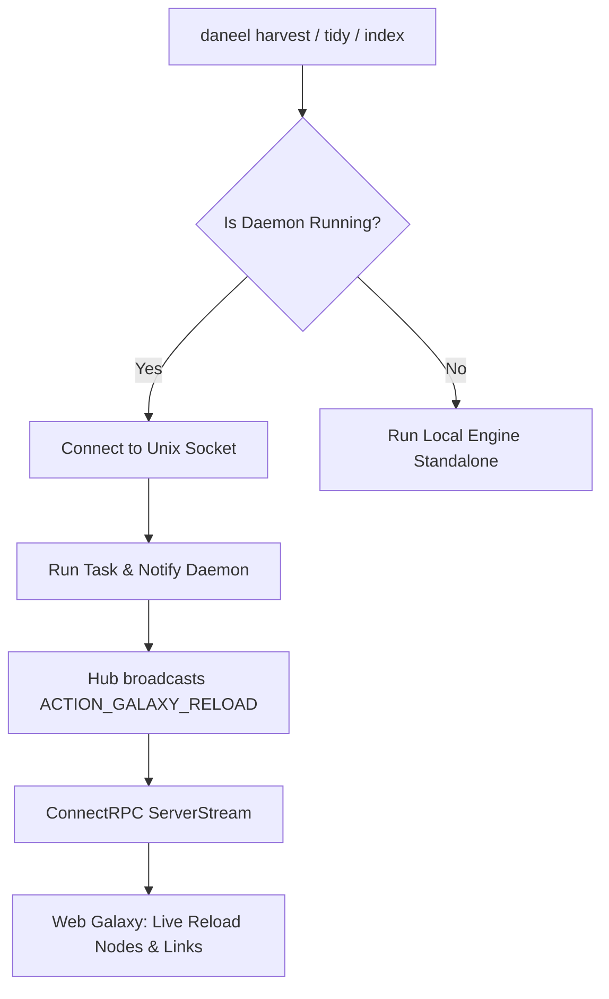

# CLI Delegation & Live Reload (`RunOrDelegate`)

To prevent SQLite write lock contention while enabling real-time visual feedback, Daneel uses the `RunOrDelegate` architectural pattern.

## 1. The Problem: Concurrency & Lock Contention

SQLite in WAL mode supports multiple concurrent readers, but only a **single writer at any given time**. If a user runs `daneel harvest` in one terminal while `daneel serve` is reindexing or `daneel tidy` is running in the background, file locks (`SQLITE_BUSY`) can occur. Furthermore, when CLI operations download or modify notes, the user's open Web browser should reflect these changes immediately without manual page refreshes.

## 2. The `RunOrDelegate` Solution

### Implementation Details
When an operation runs:
1. It attempts to connect to `~/.local/state/daneel/daneel.sock`.
2. **If Daemon is Online**: The task coordinates through the master process and dispatches `ACTION_GALAXY_RELOAD` to the Hub upon completion.
3. **If Daemon is Offline**: The command falls back seamlessly to standalone execution (`localRunner()`), ensuring Daneel remains 100% functional without requiring background services.

### Web Live Reload Handling
On the Web side, `useUIEventSync.ts` intercepts `ACTION_GALAXY_RELOAD` and triggers an in-place fetch of `/graph.v1.GraphService/GetGalaxy`, smoothly animating newly discovered stars and links into the cosmos.
