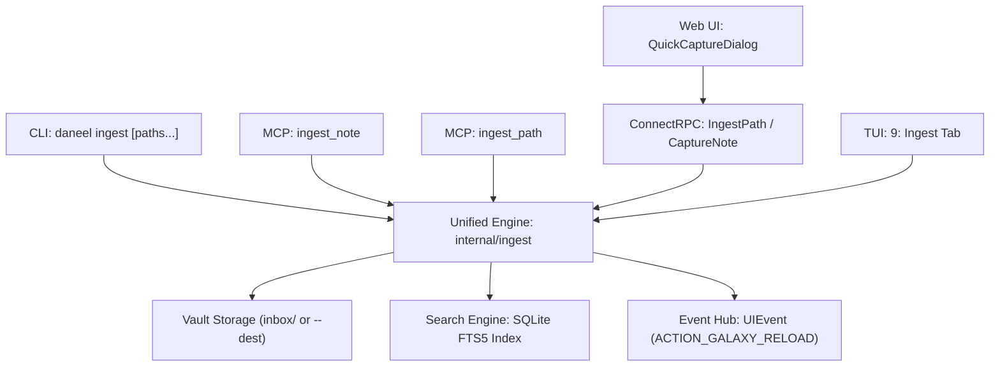

# Universal Note Ingestion Engine Design Specification

## Overview

Daneel currently provides a specialized `daneel ingest` command and an `ingest_meeting_notes` MCP tool strictly scoped to Google Meet / Gemini meeting transcript extraction into `sources/reunioes/`. However, users frequently capture notes, documents, or research across their filesystem (e.g. `~/Downloads/meeting_notes.md`, a research directory `~/Downloads/papers/`, or external folders) and need to ingest them seamlessly into their Second Brain from any location.

This design generalizes note ingestion into a universal capability across all interfaces:
1. **Core Engine (`internal/ingest`)**: Securely ingests arbitrary files, directories, or direct content into the vault, handling frontmatter preservation/synthesis, collision avoidance, path safety, and automatic SQLite FTS5 search indexing.
2. **CLI (`cmd/ingest.go`)**: Expands `daneel ingest [paths...]` to accept any host file or directory path, supporting `--dest` (default: `inbox`), `--move`, and `--reindex`, while preserving backwards compatibility when invoked without arguments for meeting drafts.
3. **ConnectRPC API (`api/v1/graph.proto`)**: Introduces `IngestPath` RPC and enhances `CaptureNote` to support target destinations.
4. **MCP Tools (`internal/mcp/server.go`)**: Introduces `ingest_note` (for raw note content + metadata) and `ingest_path` (for host file or directory ingestion).
5. **Web UI (`QuickCaptureDialog.tsx`)**: Integrates an "Import Files / Host Path" tab alongside "Write Note", with drag-and-drop file upload, file input, and host path entry.
6. **Terminal UI (`internal/tui/ingest_view.go`)**: Introduces a dedicated `"9: 📥 Ingest"` tab with an interactive file browser (`bubbles/filepicker`), manual path input, and import history.

---

## Architecture & Subsystems



---

## Detailed Component Design

### 1. Unified Ingestion Core (`internal/ingest`)

Package: `github.com/rjfonseca/daneel/internal/ingest`

#### Data Types
```go
type IngestOptions struct {
    Destination string // Relative vault directory, default: "inbox"
    Recursive   bool   // Recursively traverse directories (default: true)
    Move        bool   // Remove source file after ingestion (default: false)
    SourceURL   string // Optional origin URL or reference
    Tags        []string
}

type IngestedNote struct {
    SourcePath string `json:"source_path,omitempty"`
    RelPath    string `json:"rel_path"`
    Title      string `json:"title"`
    SizeBytes  int64  `json:"size_bytes"`
    Warning    string `json:"warning,omitempty"`
}

type IngestReport struct {
    Items          []IngestedNote `json:"items"`
    TotalProcessed int            `json:"total_processed"`
    Errors         []string       `json:"errors,omitempty"`
}
```

#### Core Engine Methods
- `NewEngine(vaultRoot string, searchEngine *search.Engine, eventHub daemon.Hub) *Engine`
- `(e *Engine) IngestPath(ctx context.Context, hostPath string, opts IngestOptions) (*IngestReport, error)`
- `(e *Engine) IngestDirectory(ctx context.Context, hostDir string, opts IngestOptions) (*IngestReport, error)`
- `(e *Engine) IngestContent(ctx context.Context, title string, content []byte, opts IngestOptions) (*IngestedNote, error)`

#### Invariants & Safety
- **Path Traversal Protection**: Target paths must resolve strictly within the configured vault directory (`filepath.Clean`, `os.OpenRoot` or strict prefix checking).
- **Symlink Boundary**: Rejects symlinks pointing outside the vault or escaping the host source.
- **Collision Avoidance**: If `destination/filename.md` exists, append timestamp or incremental suffix (`filename-20261109-170000.md`) to prevent silent overwrites.
- **Frontmatter Preservation**:
  - If existing YAML frontmatter is present in markdown, keep existing keys and add/update `title` if empty, and record `ingested_at`.
  - If no frontmatter exists, synthesize minimal frontmatter (`title`, `ingested_at`, `source_path`).
- **Meeting Note Detection**:
  - If a single markdown file contains meeting markers (e.g. Gemini / Google Meet transcript headers), it can optionally trigger participant extraction and archiving into `sources/reunioes/`.

---

### 2. CLI Extension (`cmd/ingest.go`)

- **Usage**:
  ```bash
  daneel ingest <file-or-dir> [more-paths...] [flags]
  ```
- **Flags**:
  - `-d, --dest <dir>`: Vault destination directory (default: `"inbox"`).
  - `-r, --recursive`: Recursively scan directories (default: `true`).
  - `-m, --move`: Remove source file(s) after successful ingestion (default: `false`).
  - `--reindex`: Reindex SQLite FTS5 after ingestion (default: `true`).
  - `--json`: Output structured JSON report.
- **Backwards Compatibility**:
  - If `len(args) == 0` and `--zip` is provided or nothing, run existing `meetings.Processor` pipeline in `inbox/`.
  - All existing flags (`--zip`, `--clean`, `--reindex`) continue to work seamlessly.

---

### 3. ConnectRPC Service (`api/v1/graph.proto`)

Add the following RPC and messages to `GraphService`:
```protobuf
service GraphService {
  ...
  rpc IngestPath(IngestPathRequest) returns (IngestPathResponse);
}

message IngestPathRequest {
  string path = 1;
  string destination = 2;
  bool recursive = 3;
  bool move = 4;
}

message IngestedItem {
  string source_path = 1;
  string rel_path = 2;
  string title = 3;
  int64 size_bytes = 4;
  string warning = 5;
}

message IngestPathResponse {
  repeated IngestedItem items = 1;
  int32 total_processed = 2;
  string warning = 3;
}
```
In `CaptureNoteRequest`:
```protobuf
message CaptureNoteRequest {
  string title = 1;
  string content_markdown = 2;
  string source_url = 3;
  string destination = 4; // Optional target vault folder (default: "inbox")
}
```

---

### 4. MCP Tools (`internal/mcp/server.go`)

Expose two first-class tools:
1. `ingest_note`:
   - Inputs: `title` (string, required), `content` (string, required), `destination` (string, optional), `tags` (array of string, optional), `source_url` (string, optional).
   - Behavior: Writes note directly to vault via `internal/ingest`, indexes in FTS5, dispatches `ACTION_GALAXY_RELOAD`, returns JSON result with `rel_path`.
2. `ingest_path`:
   - Inputs: `path` (string, required), `destination` (string, optional, default: `"inbox"`), `recursive` (bool, optional, default: true), `move` (bool, optional, default: false).
   - Behavior: Reads host path (file or folder), writes to vault, indexes, returns JSON report with all ingested items.

---

### 5. Web UI (`QuickCaptureDialog.tsx`)

Enhance `QuickCaptureDialog`:
- Add tab headers: `"Write Note"` (default) and `"Import Files / Host Path"`.
- Under `"Import Files / Host Path"`:
  - Drag-and-drop zone and file input button (`<input type="file" multiple accept=".md,.markdown,.txt" />`).
  - Host Path Input for direct daemon filesystem ingestion.
  - Destination input or selector (`inbox/` default).
  - Displays progress list of ingested files with direct links to focus and view notes.

---

### 6. Terminal UI (`internal/tui/ingest_view.go`)

- Add tab `"9: 📥 Ingest"` to TUI tab bar (hotkey `9` or `i`).
- View features:
  - Left pane: `bubbles/filepicker` allowing interactive navigation of local directories (`~`, `/home/...`).
  - Right pane: Selected file preview, target destination input (default: `inbox`), and action buttons (`[Enter] Ingest File`, `[d] Ingest Entire Directory`).
  - Bottom pane: History of recently ingested files in this session with status indicators (`🟢 Ingested`, `🟡 Reindexed`).

---

## Testing Strategy
- Unit tests for `internal/ingest` covering:
  - Markdown note ingestion with and without existing frontmatter.
  - Directory recursive ingestion with subdirectories.
  - Collision handling (no overwriting).
  - Symlink and path traversal rejection.
  - Reindexing and event dispatching.
- CLI tests in `cmd/ingest_test.go`.
- ConnectRPC tests in `cmd/serve_ingest_test.go`.
- MCP server tests in `internal/mcp/server_test.go`.
- Web tests in `web/tests/QuickCaptureDialog.test.tsx`.
- TUI tests in `internal/tui/ingest_view_test.go`.
