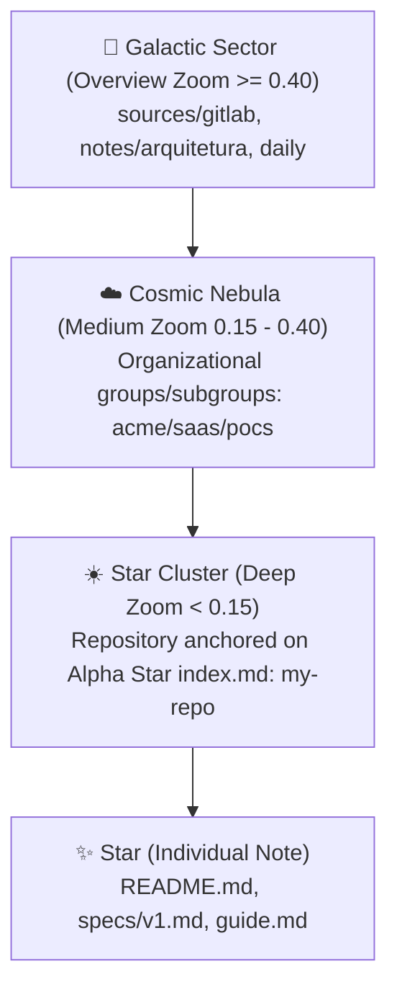

# Astrophysics Taxonomy & LOD Edge Filtering

To eliminate the "white blob" luminance collapse and complex network "hairball" effect, Daneel applies principles of astrophysics and Level of Detail (LOD) edge filtering.

## 1. The 8-Class Stellar Taxonomy

Nodes are parameterized along two physical dimensions:
- **Kinetic/Thermal Energy ($\lambda_{\text{peak}} \propto 1/T$)**: Derived from modification recency (`mtime`).
- **Gravitational Mass**: Derived from real connectivity degree in the network (`connections`).

| Class | Astrophysical Role | Rule | Visual Appearance |
|---|---|---|---|
| **Quasar (AGN)** | Active Super-Hub | Connections $\ge 15$ & Age $\le 7$ days | Blazing `#38bdf8`, radius `2.5`, radiant halo |
| **Pulsar (PSR)** | Rhythmic Log Beacon | Daily note & Age $\le 3$ days | Pulsing cyan `#67e8f9`, radius `1.8` |
| **Blue Giant (O/B)** | High-Energy Young Note | Age $\le 3$ days | Sky Blue `#60a5fa`, radius `1.5` |
| **White Star (A/F)** | Expanding Concept | $3 < \text{Age} \le 7$ days | Silver Cyan `#a5f3fc`, radius `1.1` |
| **Yellow Dwarf (G)** | Solar Maturity | $7 < \text{Age} \le 20$ days | Solar Gold `#facc15`, radius `0.85` |
| **Orange Star (K)** | Consolidated Knowledge | $\text{Age} > 20$ days & Connections $\ge 3$ | Cosmic Amber `#fb923c`, radius `0.75` |
| **Red Dwarf (M)** | Stable Reference | $\text{Age} > 20$ days & Connections $= 2$ | Soft Ruby `#f43f5e`, radius `0.60` |
| **Brown Dwarf (L/T/Y)** | Sub-stellar Leaf Note | $\text{Age} > 20$ days & Connections $\le 1$ | Muted Bronze `#78350f`, radius `0.40`, alpha `0.35` |

*Impact*: Over 70% of notes are leaf notes (Brown Dwarfs). By shrinking their radius and tinting them bronze, dense clusters transform from blinding white masses into organic, readable starfields.

## 2. Dynamic LOD Edge Filtering

The `edgeReducer` adjusts edge density dynamically based on `camera.ratio`:

1. **Overview ($\text{ratio} \ge 0.65$)**: Hides intra-cluster micro-edges. Renders only cross-cluster gravity bridges as faint filaments (`size: 0.25`, opacity 8%).
2. **Sector View ($0.35 \le \text{ratio} < 0.65$)**: Reveals intra-sector edges clearly while attenuating external edges.
3. **Deep Zoom ($\text{ratio} < 0.35$)**: Displays all local connections crisply (`size: 0.40`, opacity 22%).
4. **Interactive Focus**: Hovering or selecting any star highlights its entire constellation in electric neon violet (`rgba(168, 85, 247, 0.95)`, `size: 2.0`), cutting through all background filtering.

## 3. The 4-Tier Cosmic Hierarchy

To resolve structural ambiguities between multi-repository organizational groups and individual software projects, Daneel implements a 4-tier astrophysical model:

1. **Estrela (Star)**: Individual Markdown file classified under the 8-class stellar taxonomy.
2. **Aglomerado Estelar (Star Cluster)**: Individual repository (`sources/<platform>/.../<repo>`), anchored on its `index.md` (Alpha Star / Núcleo do Cluster, badge `☀️ CLUSTER CORE`, radius `2.2`). ForceAtlas2 gravitational edges bind all document stars to this core.
3. **Nebulosa (Nebula)**: Organizational group or subgroup (e.g. `saas/pocs`), anchored on its group MOC (`index.md`, badge `🌌 NEBULA CORE`, radius `1.8`).
4. **Setor Galáctico (Galactic Sector)**: Macro territory (`sources/gitlab`, `notes/arquitetura`, etc.), visible at panoramic zoom.

## 4. Hierarchical Sector & Repository LOD Labels

Daneel applies progressive LOD disclosure to visual labels:

1. **Overview Zoom ($\text{ratio} \ge 0.40$)**:
   - Prominent **Domain / Sector HUD Glass Callouts** (`__SECTOR_`) are rendered with cybernetic styling (`rgba(10, 15, 30, 0.92)`, corner ticks `⌜ ⌝ ⌞ ⌟`, `◈ DOMAIN` micro-header, aggregate telemetry `N repos · M notes`, and a glowing diamond beacon reticle `◈`).
   - Granular repository labels (`__CAT_`) are suppressed to avoid visual crowding.
   - Strategic level-1 notes (`notes/*`) remain permanently visible as core knowledge pillars.
   - Domains/sectors strictly respect the user's `maxNebulas` budget.
2. **Medium Zoom ($0.15 \le \text{ratio} < 0.40$)**:
   - Sector HUD callouts yield to Cosmic Nebulas (organizational groups/subgroups).
3. **Deep Zoom ($\text{ratio} < 0.15$)**:
   - Star Clusters (repositories anchored on their `index.md` Alpha Star) and individual note labels are revealed.
4. **Interactive Sector Tethers**:
   - Hovering over any sector anchor illuminates its gravitational tether edges in the sector's neon color, visualizing its member repository topology.

